# Valora

[](https://github.com/Hikki-dev/valora/actions/workflows/flutter_cicd.yml)
[](LICENSE)
[](https://github.com/Hikki-dev/valora/releases/latest)
[](https://valora-umber.vercel.app)
[](https://flutter.dev)
[](https://supabase.com)

Find out what your game collection is worth, and watch it change.

<p align="center">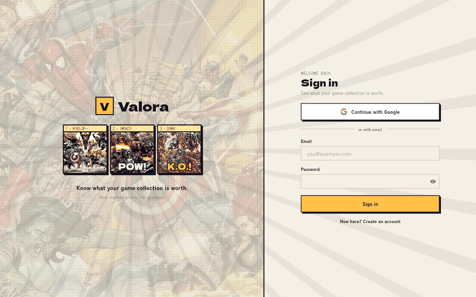</p>

<p align="center"><sub>The sign-in page on a computer and on a phone. <b><a href="https://valora-umber.vercel.app">Open the live site</a></b> to try it yourself.</sub></p>

Add the games you own, physical or digital. Valora looks up what each one sells for today, keeps the price with its date, and adds your whole shelf up for you. It works in the browser and on your phone.

You do not need to know anything about prices or investing. Everything is explained in plain words on the way.

## On this page

* [What you get](#what-you-get): the parts of the app, in one table
* [How everything fits together](#how-everything-fits-together): one game, from adding it to seeing its price
* [Try it first](#try-it-first): the live site and Android builds
* [The app, step by step](#the-app-step-by-step)
  * [1. Sign in](#1-sign-in)
  * [2. Add a game](#2-add-a-game) (also scan a barcode, or bring in all of Steam)
  * [3. Home](#3-home)
  * [4. Library](#4-library)
  * [5. A game's page](#5-a-games-page)
  * [6. Wishlist](#6-wishlist)
  * [7. Insights](#7-insights)
  * [8. Settings](#8-settings)
  * [9. Dark mode](#9-dark-mode)
  * [On a phone](#on-a-phone): all nine screens in one row
* [Where prices come from](#where-prices-come-from)
* [Your privacy and safety](#your-privacy-and-safety)
* [Run your own copy](#run-your-own-copy)
* [Look and feel](#look-and-feel)
* [Help and more reading](#help-and-more-reading)
* [Legal and responsibility](#legal-and-responsibility)

## What you get

| Part | What it does |
|---|---|
| **Home** | The total value of your collection, how it moved, a total for each platform, and your most valuable games |
| **Library** | Every game you own. Search, filter by platform, sort, and (on a computer) switch between a grid and a list |
| **Game page** | Its value, a value history chart, a price for each condition, and what you paid |
| **Wishlist** | Games you want, with a target price. It tags a game when it reaches that price |
| **Insights** | How many games are priced, the average, your top game, and a ranked list |
| **Steam import** | Brings in your Steam library in one go, using your Steam ID |
| **Barcode scanner** | Scan the barcode on a boxed game to look it up |
| **Share a snapshot** | A picture of your ten most valuable games, made on your phone |
| **Settings** | Light or dark mode, US dollars or Sri Lankan rupees, and a switch to hide the numbers |

When a game has no price, Valora shows a dash. It never shows a made up number.

## How everything fits together

You add a game, and Valora does the rest. The app saves it in a locked database, asks a small server function for the price, and saves that price with today's date. Every day a job marks the wishlist games that reached your target.

<p align="center"><a href="docs/images/how-it-fits.svg">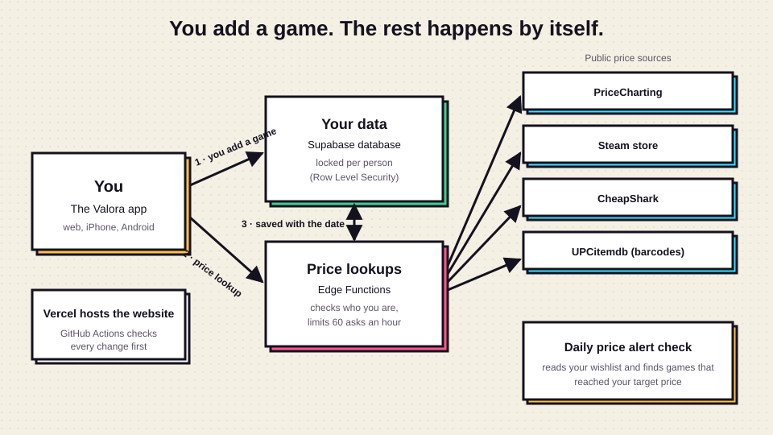</a></p>

Click the picture to see it full size. The full story, part by part, is in [How everything fits](docs/How%20everything%20fits.md).

## Try it first

* **[Open the live site](https://valora-umber.vercel.app).** Sign in with Google or an email address. It works on phones too.
* **[Get an Android build](https://github.com/Hikki-dev/valora/releases/latest).** Every change to `main` that touches the app publishes a new APK.

## The app, step by step

Every screen explains itself in plain words, so you can go at your own pace. Click a picture to see it full size. The pictures show the real screens filled with made-up demo games: the games and prices are samples, not a real collection, and covers appear as plain title tiles. The same walk through, with more detail, is in [Getting started](docs/Getting%20started.md).

### 1. Sign in

<a href="docs/images/login-desktop.png">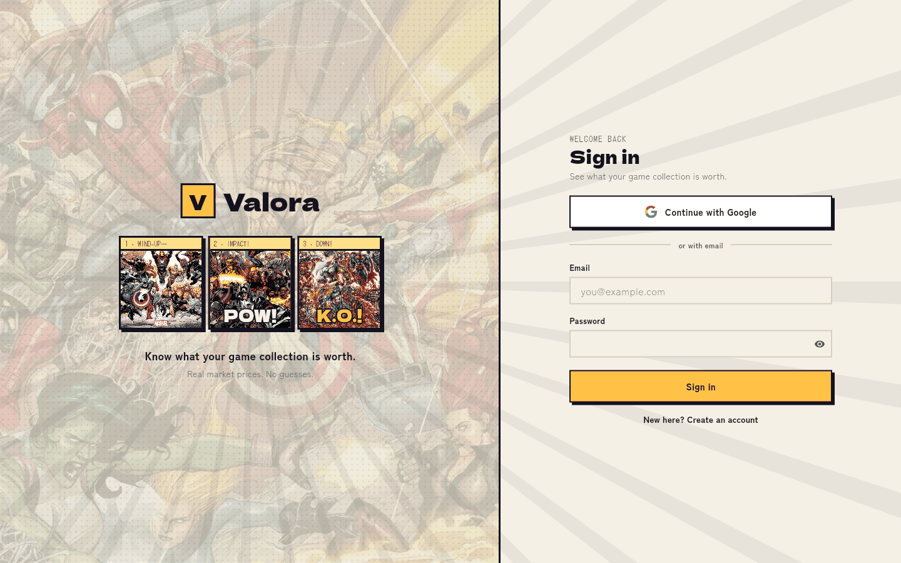</a>

Choose **Continue with Google**, or use an email and a password. Valora never sees your Google password.

### 2. Add a game

<a href="docs/images/add-game-desktop.png">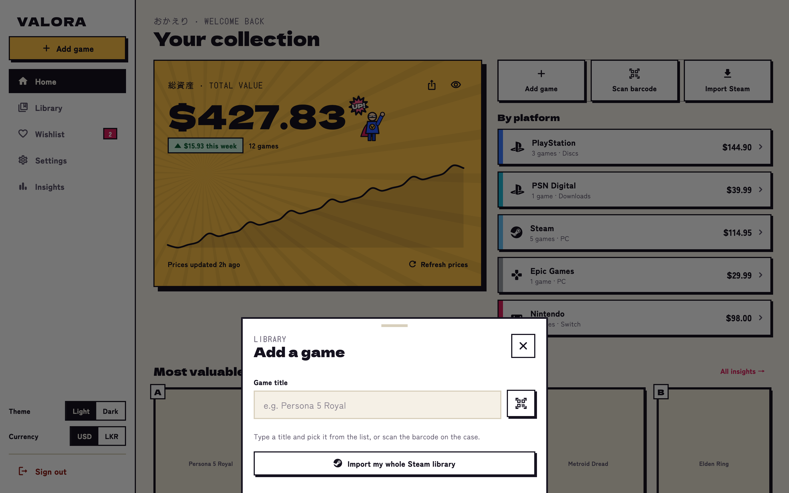</a>

Press **Add game** (on Home, or in the side menu on a computer). Type the title and pick it from the list, or press the barcode button beside the box and scan the case. If you use Steam, **Import my whole Steam library** brings in every game at once. It asks for your Steam ID (the number that identifies your Steam profile), and the import screen shows you how to find it.

After you pick a game, the sheet asks for a few details:

* **Platform:** PlayStation 5, PlayStation 4, Nintendo, Steam or Epic Games.
* **Format:** Physical or Digital.
* **For a physical game:** the region (R1 USA, R2 UK/EU, R3 Asia or Japan) and the shape of your copy: **Game only** (just the disc or cartridge), **Complete** (game, case and manual) or **Sealed** (still in the shrink-wrap). A sealed game is worth more than a loose disc, so this matters.
* **What you paid** (optional). Valora uses it to work out your profit or loss.
* **Market value.** Filled in from live prices. Change it only if you know better.

Press **Add to library** and the game is saved. A game you only want goes to the Wishlist instead.

### 3. Home

<a href="docs/images/home-desktop.png">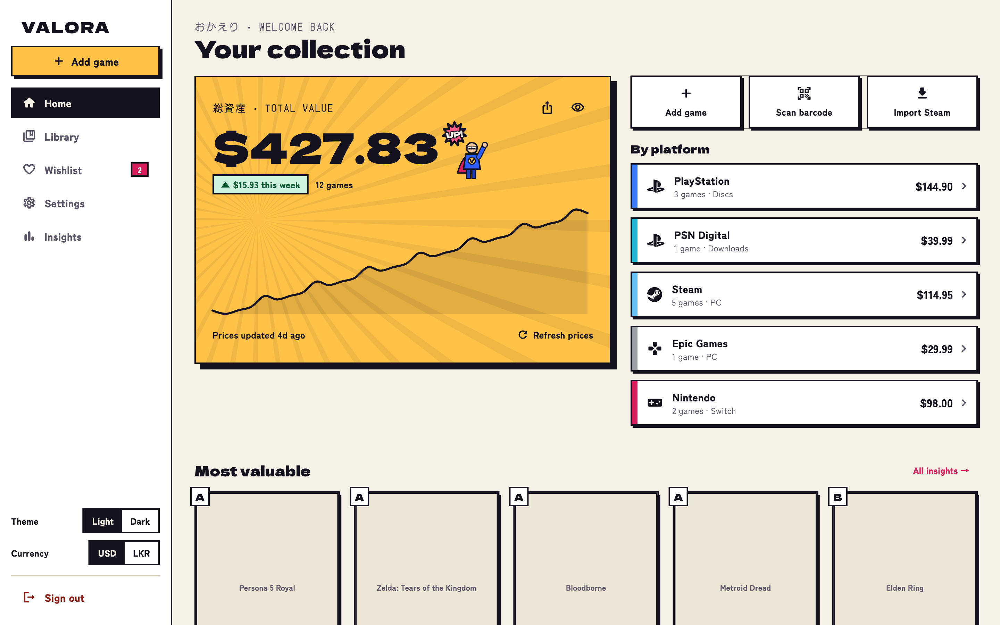</a>

Home answers one question: what is my collection worth today? The big yellow card shows the total, how much it moved this week, a chart of how it moved, and how long ago the prices were updated. **Refresh prices** looks everything up again.

* The **share** button makes a picture of your ten most valuable games on a phone. On the web it shares a short text message instead.
* The **eye** button hides every price, which is handy when you show someone your screen.
* On a computer, **By platform** adds up PlayStation, PSN Digital, Steam, Epic Games and Nintendo separately.
* **Most valuable** lists your top games. The letter on each cover is a rank: **S** is worth $100 or more, **A** is $40 or more, and **B** is below that.

A game with no price is left out of the total, so the total is never wrong in secret.

### 4. Library

<a href="docs/images/library-desktop.png">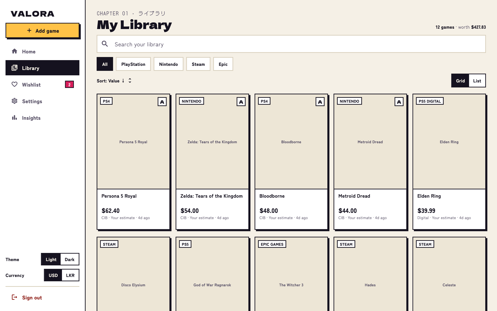</a>

Every game in one place. Search waits until you stop typing, so it stays smooth with thousands of games. Filter by PlayStation, Nintendo, Steam or Epic, and sort by value, name or most recently added.

On a computer you can also switch from the grid to a list, which shows more at once:

<a href="docs/images/library-list-desktop.png">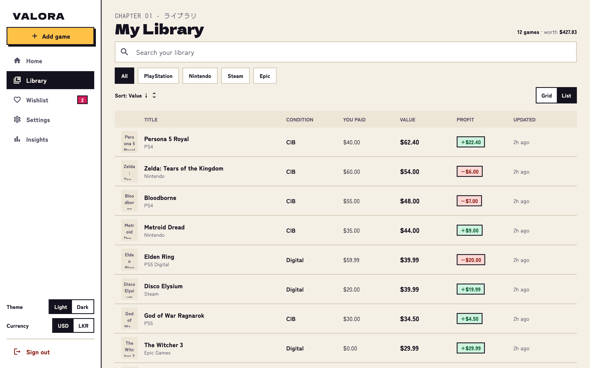</a>

### 5. A game's page

<a href="docs/images/game-desktop.png">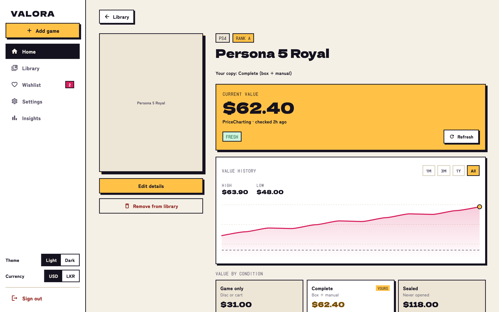</a>

Open a game to see its **current value** for the copy you own, where the price came from, and how fresh it is. A small tag says **Fresh** or **Out of date**, and **Refresh** looks it up again.

Under that you get:

* **Value history**, with **1M**, **3M**, **1Y** and **All** buttons. The chart fills in as Valora saves new prices.
* **Value by condition**: the price for **Game only**, **Complete** and **Sealed**, with a **Yours** tag on the one you own. A digital game shows its store price.
* **What you paid** and your profit or loss, once you add it with **Edit details**.
* **Remove from library**. A removal can be undone for a few seconds.

### 6. Wishlist

<a href="docs/images/wishlist-desktop.png">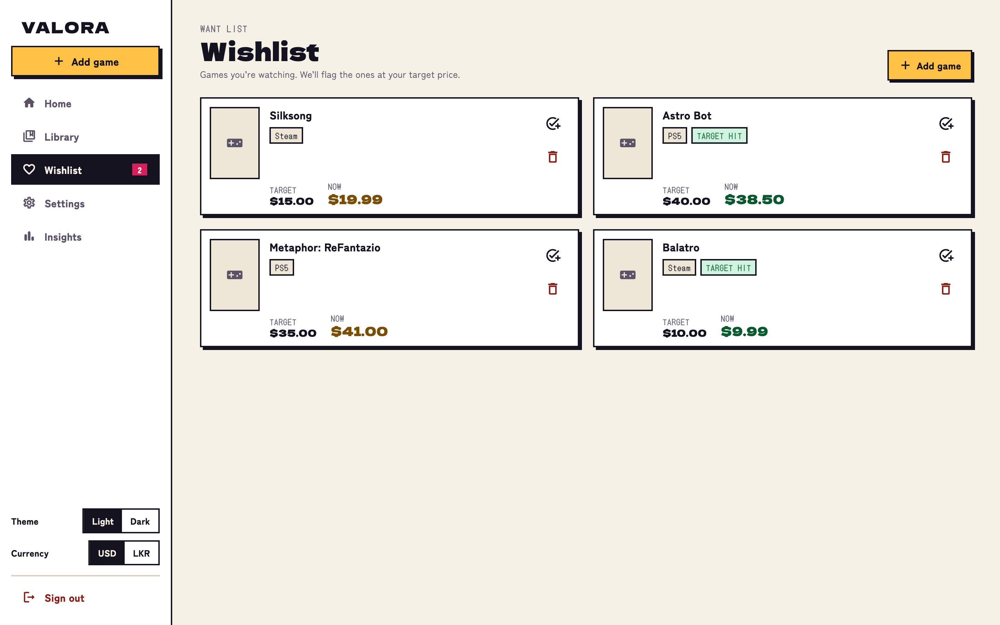</a>

Add a game you want and set a **target price**. Each card shows the target and the price now. When the price reaches your target, the card is tagged **Target hit**, and the Wishlist button shows a red number, so you know it is time to buy. The check also runs once a day.

### 7. Insights

<a href="docs/images/insights-desktop.png">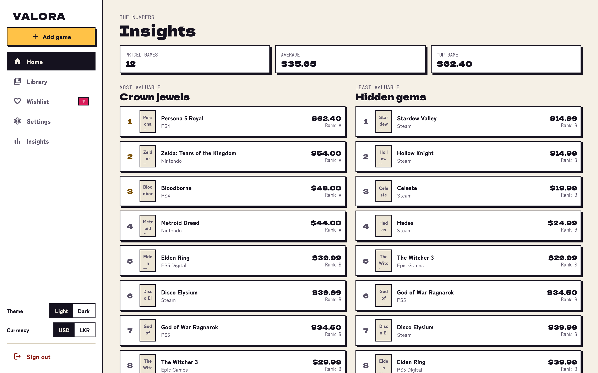</a>

Three numbers (games with a price, the average, your top game), then your games ranked from most to least valuable. Games with no market price yet are not ranked. Insights tells you how many there are. It is a good page to look at before you decide what to sell.

### 8. Settings

<a href="docs/images/settings-desktop.png">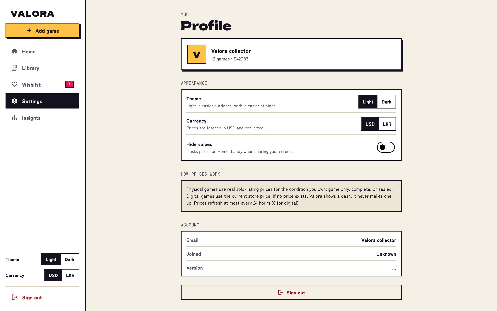</a>

**Profile** and settings are in one place:

* **Theme:** light or dark.
* **Currency:** prices are fetched in US dollars and converted to Sri Lankan rupees if you choose LKR.
* **Hide values:** masks prices on Home.
* **How prices work:** a short reminder, in plain words, of where prices come from.
* **Account:** your email, when you joined, the app version, and **Sign out**.

### 9. Dark mode

<a href="docs/images/home-dark-desktop.png">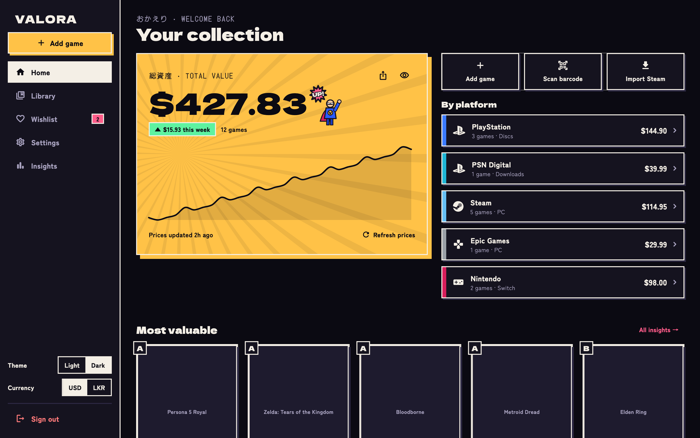</a>

Light is the default. Switch to dark in Settings, with the moon button on a phone, or in the side menu on a computer. Valora remembers your choice.

### On a phone

The nine screens above, on a phone, left to right. The number matches the step. Click a picture to see it full size.

<table>
<tr>
<td valign="top"><a href="docs/images/login-mobile.png">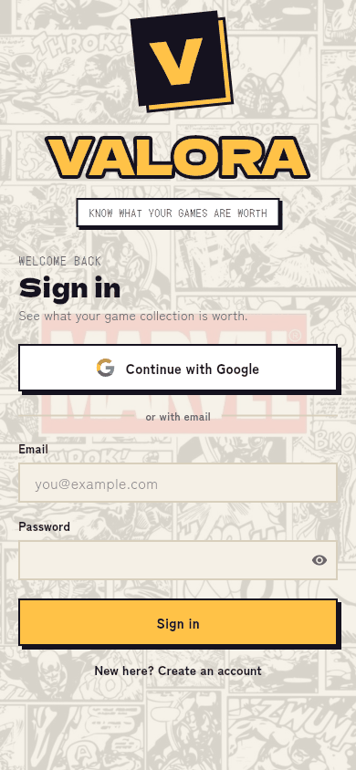</a></td>
<td valign="top"><a href="docs/images/add-game-mobile.png">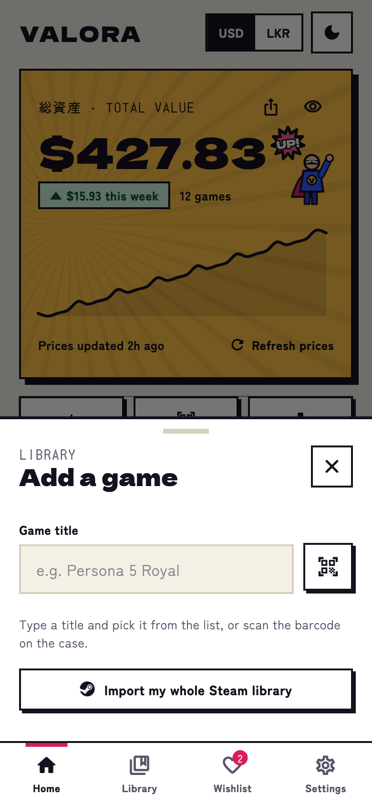</a></td>
<td valign="top"><a href="docs/images/home-mobile.png">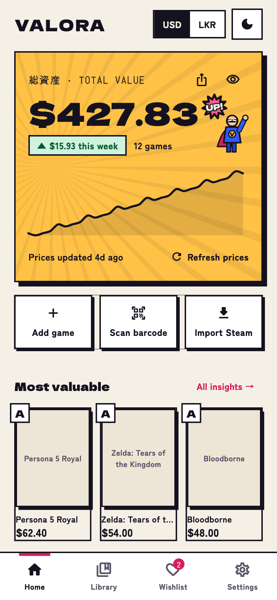</a></td>
<td valign="top"><a href="docs/images/library-mobile.png">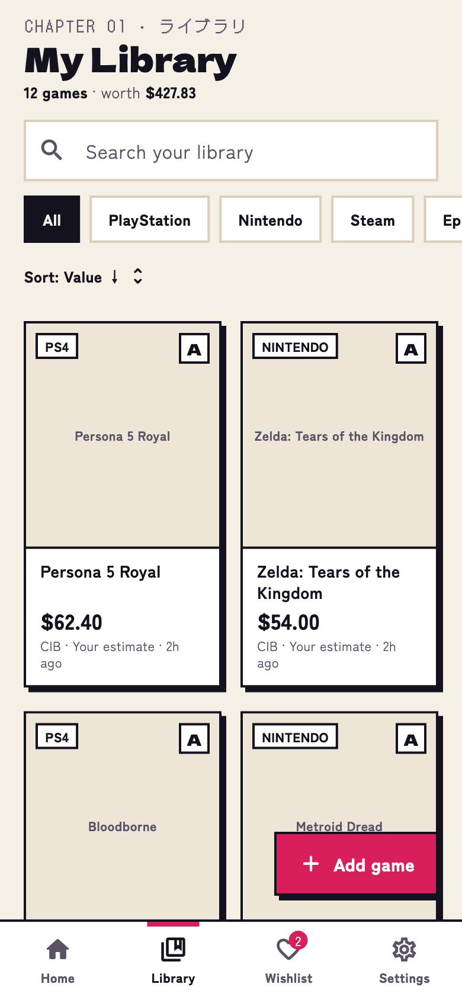</a></td>
<td valign="top"><a href="docs/images/game-mobile.png">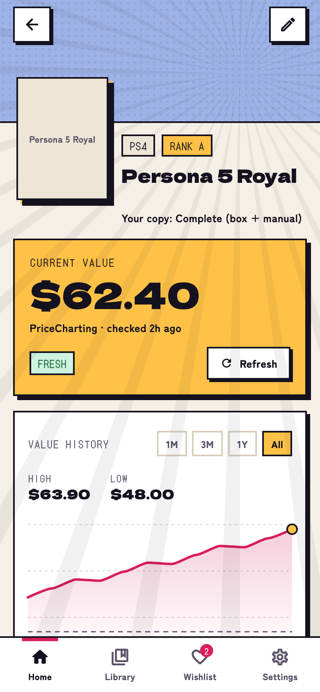</a></td>
</tr>
<tr>
<td align="center" valign="top"><b>1</b><br><sub>Sign in</sub></td>
<td align="center" valign="top"><b>2</b><br><sub>Add a game</sub></td>
<td align="center" valign="top"><b>3</b><br><sub>Home</sub></td>
<td align="center" valign="top"><b>4</b><br><sub>Library</sub></td>
<td align="center" valign="top"><b>5</b><br><sub>A game's page</sub></td>
</tr>
</table>

<table>
<tr>
<td valign="top"><a href="docs/images/wishlist-mobile.png">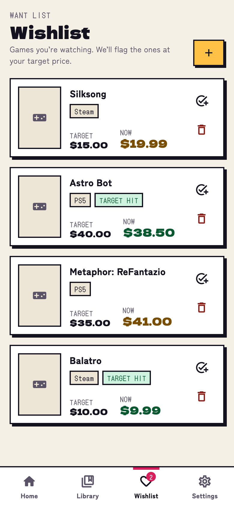</a></td>
<td valign="top"><a href="docs/images/insights-mobile.png">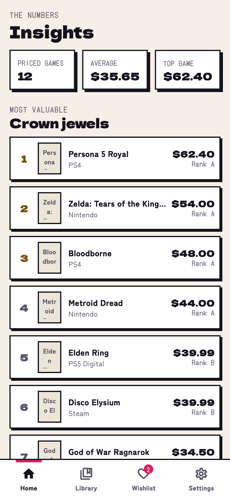</a></td>
<td valign="top"><a href="docs/images/settings-mobile.png">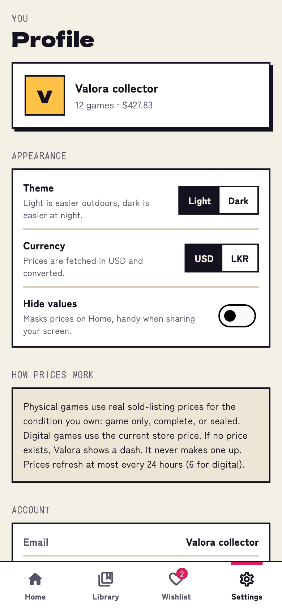</a></td>
<td valign="top"><a href="docs/images/home-dark-mobile.png">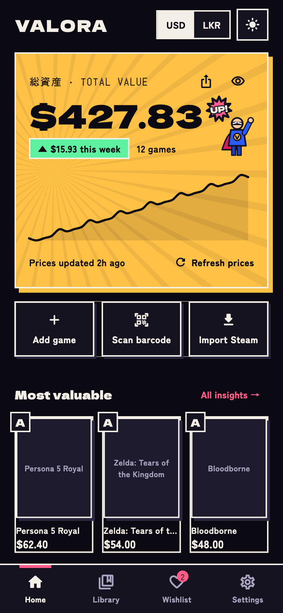</a></td>
</tr>
<tr>
<td align="center" valign="top"><b>6</b><br><sub>Wishlist</sub></td>
<td align="center" valign="top"><b>7</b><br><sub>Insights</sub></td>
<td align="center" valign="top"><b>8</b><br><sub>Settings</sub></td>
<td align="center" valign="top"><b>9</b><br><sub>Dark mode</sub></td>
</tr>
</table>

## Where prices come from

Disc games are looked up at PriceCharting, Steam games at the Steam store, and other digital games at CheapShark. Prices are saved with their date, and reused for 24 hours (disc) or 6 hours (digital), so the app stays fast.

A price is an estimate, not an offer. The details, including what happens when there is no price, are in [Where prices come from](docs/Where%20prices%20come%20from.md).

## Your privacy and safety

* **Only you can see your games.** Every table is locked with Row Level Security, so one person can never read another person's collection.
* **Your Google password never reaches Valora.** Sign-in uses Google's signed ID token.
* **Secret keys stay out of the code.** The app only holds the publishable key, which is meant to be public. Powerful keys live in the server's secret store.
* **No selling of data and no adverts.**
* **Safe connections.** All traffic uses HTTPS, and the website sends security headers (see `vercel.json`).

The full picture is in [Your privacy and data](docs/Your%20privacy%20and%20data.md). To report a problem privately, read [SECURITY.md](SECURITY.md).

## Run your own copy

You need [Flutter](https://docs.flutter.dev/get-started/install) **3.41.4**, a free [Supabase](https://supabase.com) project and the Supabase CLI.

```bash
git clone https://github.com/Hikki-dev/valora.git
cd valora
flutter pub get
```

Put your project's address and publishable key in a file called `.env.build`. Git ignores it, so it stays on your computer:

```json
{
  "SUPABASE_URL": "https://your-project.supabase.co",
  "SUPABASE_ANON_KEY": "your-publishable-key"
}
```

```bash
flutter run -d chrome --dart-define-from-file=.env.build
```

Without those two values the app shows a "Configuration Missing" page instead of starting. That is on purpose.

Setting up the database, the secrets and the price lookups, and putting it on the web, are covered one step at a time in [Running it yourself](docs/Running%20it%20yourself.md). Before you push a change, run:

```bash
dart format .
flutter analyze
flutter test
```

## Look and feel

The design is called **Midnight Manga**: bold outlines, hard shadows and comic panels, light by default with a dark theme you can switch to.

On a computer (900 pixels wide or more) the left side shows a landscape picture, the Valora name and three comic panels. On a phone, a large Valora logo sits above the form, and the panels are left out so the form comes first. The rules behind the look are in [Design](docs/Design.md).

## Help and more reading

| Page | What it answers |
|---|---|
| [Getting started](docs/Getting%20started.md) | How do I use each screen? |
| [How everything fits](docs/How%20everything%20fits.md) | What are the parts, and how do they work together? |
| [Where prices come from](docs/Where%20prices%20come%20from.md) | Where does a price come from, and how fresh is it? |
| [Your privacy and data](docs/Your%20privacy%20and%20data.md) | What is kept, and who can see it? |
| [Running it yourself](docs/Running%20it%20yourself.md) | How do I set up my own copy? |
| [Design](docs/Design.md) | Why does it look like this, and what are the rules? |
| [FAQ](docs/FAQ.md) | Quick answers |
| [Fixing problems](docs/Fixing%20problems.md) | Something does not look right |
| [CHANGELOG](CHANGELOG.md) | What changed in each version |

## Legal and responsibility

Prices are estimates from public market data. They are not an offer to buy or sell, and not financial advice. What a game really sells for depends on the buyer, the condition and the day.

Game names, console names and logos belong to their owners. Valora is not made by or connected to them.

The comic pictures in `assets/art` are artwork from third parties. Make sure you are allowed to use them before you publish your own copy of this project.

## Contributing

Pull requests are welcome. Read [CONTRIBUTING.md](CONTRIBUTING.md) first. It is short.

## Credits

Prices come from [PriceCharting](https://www.pricecharting.com), the [Steam store](https://store.steampowered.com) and [CheapShark](https://www.cheapshark.com). Barcodes are looked up with [UPCitemdb](https://www.upcitemdb.com). Built with [Flutter](https://flutter.dev) and [Supabase](https://supabase.com), and hosted on [Vercel](https://vercel.com). The fonts are Dela Gothic One, Zen Kaku Gothic New and DotGothic16, under the SIL Open Font Licence.

## Licence

MIT. See [LICENSE](LICENSE).
